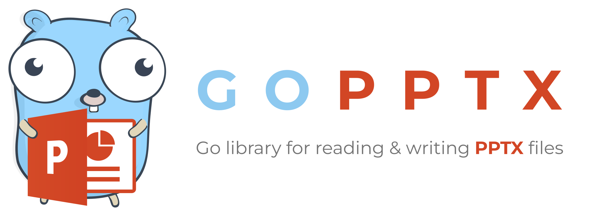

<p align="center"></p>

<p align="center">
    <a href="https://pkg.go.dev/github.com/kenny-not-dead/gopptx"></a>
    <a href="https://opensource.org/licenses/BSD-3-Clause"></a>
</p>


# GoPPTX

## Introduction

GoPPTX is a library written in pure Go providing a set of functions that allow you to write to and read from PPTX files. Supports reading and writing presentation documents generated by Microsoft PowerPoint&trade; 2007 and later. Supports complex components by high compatibility, and provided streaming API for generating or reading data from a presentation with huge amounts of data. This library needs Go version 1.24.0 or later. The full docs can be seen using go's built-in documentation tool, or online at [go.dev](https://pkg.go.dev/github.com/kenny-not-dead/gopptx).

## Basic Usage

### Installation

```bash
go get github.com/kenny-not-dead/gopptx
```
### Create presentation

The following constitutes the bare to create a presentation document.

```go
package main

import (
    "fmt"

	"github.com/kenny-not-dead/gopptx"
)

func main() {
	f := gopptx.NewFile()
    defer func() {
        if err := f.Close(); err != nil {
            fmt.Println(err)
        }
    }()

    id ,err := f.NewSlide()
	if err != nil {
        fmt.Println(err)

		return
	}

	title := gopptx.DecodeTextBody{
		BodyProperties: &gopptx.DecodeBodyProperties{
			LIns:      &value,
			RIns:      &value,
			TIns:      &value,
			BIns:      &value,
			Anchor:    &anchor,
			NoAutofit: &gopptx.NoAutofit{},
		},
		Paragraph: []gopptx.DecodeParagraph{
			{
				ParagraphProperties: &gopptx.ParagraphProperties{
					Indent: &value,
					Align:  &anchor,
				},
				Runs: []gopptx.DecodeRuns{
					{
						RunProperties: &gopptx.DecodeRunProperties{
							Bold: &value,
							Lang: "en-US",
							Size: &size,
							Strike: "noStrike",
							Space: &space,
							SolidFill: &gopptx.DecodeSolidFill{
								SolidRGBColor: &gopptx.SolidRGBColor{
									Val: "00008b",
								},
							},
							Latin: &gopptx.Latin{
								Typeface: "Arial",
							},
						},
						Text: "GOPPTX v0.3.1",
					},
				},
			},
		},
	}

	// 7 is default shapeID
	err = f.SetShapeTextBody(id, 7, title)
    if err != nil {
        fmt.Println(err)

		return
	}

	shapeProperties := gopptx.DecodeShapeProperties{
		Xfrm: &gopptx.DecodeXfrm{
			Offset: &gopptx.Offset{
				X: 1697760,
				Y: 1828800,
			},
			Extents: &gopptx.Extents{
				CX: 2417040,
				CY: 685800,
			},
		},
		PresetGeometry: &gopptx.DecodePresetGeometry{
			Preset: "rect",
		},
	}

	// 256 is default slideID, 8 is default shapeID
	err = f.DeleteShape(256, 8)
	if err != nil {
		fmt.Println("err: ", err)
	}

	_, err = f.CreateShape(256, shapeProperties, title)
	if err != nil {
		fmt.Println(err)
	}

    // Set the position and the size (a:xfrm) of the shape by the slide id
    // and the shape id.
    err = f.SetShapeXfrm(256, 8, gopptx.DecodeXfrm{
        Offset: &gopptx.Offset{
            X: 1697760,
            Y: 1828800,
        },
        Extents: &gopptx.Extents{
            CX: 2417040,
            CY: 685800,
        },
    })
    if err != nil {
        fmt.Println(err)
        return
    }

    err := f.SaveAs("presentation.pptx")
	if err != nil {
        fmt.Println(err)

		return
	}
}
```

### Reading presentation

The following constitutes the bare to read a presentation document.

```go
package main

import (
    "fmt"

	"github.com/kenny-not-dead/gopptx"
)

func main() {
    f, err := gopptx.OpenFile("presentation.pptx")
    if err != nil {
        fmt.Println(err)
        return
    }
    defer func() {
        // Close the presentation.
        if err := f.Close(); err != nil {
            fmt.Println(err)
        }
    }()
    // Get shapes from slide by given slude name.
	for _, slide := range f.Presentation.Slides.Slide {
		shapes, err := f.GetShapes(slide.ID)
		if err != nil {
			return
		}

		for _, shape := range shapes {
			fmt.Println(shape.TextBody)
		}
	}
}
```

### Working with images

Images in a presentation are stored as media parts in the `ppt/media` folder and
are referenced from slides by relationships (the `r:embed` value of the picture
blip). The following constitutes the bare to read and write images.

```go
package main

import (
    "fmt"

    "github.com/kenny-not-dead/gopptx"
)

func main() {
    f, err := gopptx.OpenFile("presentation.pptx")
    if err != nil {
        fmt.Println(err)
        return
    }
    defer func() {
        // Close the presentation.
        if err := f.Close(); err != nil {
            fmt.Println(err)
        }
    }()

    // 256 is the slide id, get pictures (p:pic shapes) of the slide.
    pictures, err := f.GetPictures(256)
    if err != nil {
        fmt.Println(err)
        return
    }

    // Get the image data by the relationship id (r:embed) of the picture blip.
    for _, picture := range pictures {
        embed := picture.BlipFill.Blip.Embed
        data, err := f.GetImage(256, embed)
        if err != nil {
            fmt.Println(err)
            return
        }
        fmt.Println(embed, len(data))
    }

    // Replace the image data referenced by the relationship id, the media
    // part is updated in place.
    if err := f.SetImage(256, "rId3", newData); err != nil {
        fmt.Println(err)
        return
    }
}
```

### Add picture to presentation file

```go
package main

import (
    "fmt"

    "github.com/kenny-not-dead/gopptx"
)

func main() {
    f, err := gopptx.OpenFile("presentation.pptx")
    if err != nil {
        fmt.Println(err)
        return
    }
    defer func() {
        // Close the presentation.
        if err := f.Close(); err != nil {
            fmt.Println(err)
        }
    }()
    // Insert a picture.
    if _, err = f.AddImage(256, "image.png", nil); err != nil {
        fmt.Println(err)
    }
    // Insert a picture to the slide with scaling.
    if _, err = f.AddImage(256, "image.jpg",
        &gopptx.PictureOptions{ScaleX: 0.5, ScaleY: 0.5}); err != nil {
        fmt.Println(err)
    }
    // Insert a picture with the position on the slide.
    if _, err = f.AddImage(256, "image.gif", &gopptx.PictureOptions{
        Name:    "Logo",
        OffsetX: 457200,
        OffsetY: 381000,
    }); err != nil {
        fmt.Println(err)
    }
    // Save the presentation with the origin path.
    if err = f.Save(); err != nil {
        fmt.Println(err)
    }
}
```

The picture is centered on the slide and scaled to fit 80% of the slide
size, keeping the aspect ratio of the image without upscaling, by default.
Duplicate images are only actually stored once and the pictures that use it
reference the same media part.

### Delete picture from presentation file

```go
package main

import (
    "fmt"

    "github.com/kenny-not-dead/gopptx"
)

func main() {
    f, err := gopptx.OpenFile("presentation.pptx")
    if err != nil {
        fmt.Println(err)
        return
    }
    defer func() {
        // Close the presentation.
        if err := f.Close(); err != nil {
            fmt.Println(err)
        }
    }()
    // Get pictures (p:pic shapes) of the slide 256.
    pictures, err := f.GetPictures(256)
    if err != nil {
        fmt.Println(err)
        return
    }
    // Delete the picture by the slide id and the picture id (the id
    // attribute of the p:cNvPr element).
    for _, picture := range pictures {
        id := picture.NonVisualPictureProperties.CommonNonVisualProperties.ID
        if err := f.DeleteImage(256, id); err != nil {
            fmt.Println(err)
            return
        }
    }
    // Save the presentation with the origin path.
    if err = f.Save(); err != nil {
        fmt.Println(err)
    }
}
```

The image relationship is removed from the slide rels part when no other
shape of the slide uses it, and the media part is removed from the package
when no other part of the presentation references it anymore.

Supported image formats are JPEG, PNG, GIF, BMP, TIFF, WEBP, ICO, EMF, WMF and
SVG.

### Working with connectors

Connectors (the `p:cxnSp` shapes — the lines that link shapes on a slide) can be
created, read, deleted and are preserved on save. The following constitutes the
bare to work with the connectors of a slide.

```go
package main

import (
    "fmt"

    "github.com/kenny-not-dead/gopptx"
)

func main() {
    f, err := gopptx.OpenFile("presentation.pptx")
    if err != nil {
        fmt.Println(err)
        return
    }
    defer func() {
        // Close the presentation.
        if err := f.Close(); err != nil {
            fmt.Println(err)
        }
    }()

    // Create a connector on the slide 256: a straight line with a width,
    // a color and the "dash" style (all the line properties are in
    // DecodeLine, the same way the shapes use it).
    width := 19050
    id, err := f.CreateConnector(256, gopptx.DecodeShapeProperties{
        Xfrm: &gopptx.DecodeXfrm{
            Offset:  &gopptx.Offset{X: 457200, Y: 381000},
            Extents: &gopptx.Extents{CX: 9144000, CY: 0},
        },
        PresetGeometry: &gopptx.DecodePresetGeometry{Preset: "straightConnector1"},
        Ln: &gopptx.DecodeLine{
            Width: &width,
            SolidFill: &gopptx.DecodeSolidFill{
                SolidRGBColor: &gopptx.SolidRGBColor{Val: "394655"},
            },
            PresetDash: &gopptx.PresetDash{Val: "dash"},
        },
    })
    if err != nil {
        fmt.Println(err)
        return
    }
    fmt.Println("created the connector", id)

    // Get the connectors (p:cxnSp shapes) of the slide.
    connectors, err := f.GetConnectors(256)
    if err != nil {
        fmt.Println(err)
        return
    }
    for _, connector := range connectors {
        info := connector.NonVisualConnectorProperties.CommonNonVisualProperties
        fmt.Println(info.ID, info.Name)
    }

    // Get a single connector by the id attribute of its p:cNvPr element.
    if connector, err := f.GetConnector(256, id); err != nil {
        fmt.Println(err)
        return
    } else {
        fmt.Println(connector.ShapeProperties.PresetGeometry.Preset)
    }

    // Delete the connector by the slide id and the connector id.
    if err := f.DeleteConnector(256, id); err != nil {
        fmt.Println(err)
        return
    }

    // Save the presentation with the origin path.
    if err := f.Save(); err != nil {
        fmt.Println(err)
        return
    }
}
```

When a slide is modified and saved, the connectors of the slide are preserved
together with the shapes and the pictures, including the line properties
(`a:ln`: width, color, dash style) and the `a16:creationId` extension
(`p:cNvPr/a:extLst`).

### Working with tables

Tables in a presentation are stored as the `a:tbl` element of the
`p:graphicFrame` shape of the slide shape tree. The following constitutes the
bare to add a table, set a cell, read the tables of the slide and delete a
table.

```go
package main

import (
    "fmt"

    "github.com/kenny-not-dead/gopptx"
)

func main() {
    f, err := gopptx.OpenFile("presentation.pptx")
    if err != nil {
        fmt.Println(err)
        return
    }
    defer func() {
        // Close the presentation.
        if err := f.Close(); err != nil {
            fmt.Println(err)
        }
    }()

    // Add a table to the slide, the new graphic frame is appended to the end
    // of the shape tree (by default the table is centered, taking 80% of the
    // slide size).
    tableID, err := f.AddTable(256, &gopptx.TableOptions{
        Rows: 3,
        Cols: 2,
        Name: "Table 1",
    })
    if err != nil {
        fmt.Println(err)
        return
    }
    fmt.Println("added the table", tableID)

    // Set the text of the cell (0, 0).
    if err := f.SetTableCellText(256, tableID, 0, 0, "Hello"); err != nil {
        fmt.Println(err)
        return
    }

    // Get the tables (the p:graphicFrame shapes with the a:tbl element) of
    // the slide: the graphic frames are returned by value, the same way
    // GetShapes returns the shapes, and the table data (a:tbl) is in the
    // graphic data.
    tables, err := f.GetTables(256)
    if err != nil {
        fmt.Println(err)
        return
    }
    for _, table := range tables {
        nv := table.NonVisualGraphicFrameProperties.CommonNonVisualProperties
        fmt.Println(nv.ID, nv.Name, len(table.Graphic.GraphicData.Table.TableRows))
    }

    // Get a single table by the id attribute of its p:cNvPr element.
    if table, err := f.GetTable(256, tableID); err != nil {
        fmt.Println(err)
        return
    } else {
        nv := table.NonVisualGraphicFrameProperties.CommonNonVisualProperties
        fmt.Println(nv.ID, nv.Name)
    }

    // Delete the table by the slide id and the table id.
    if err := f.DeleteTable(256, tableID); err != nil {
        fmt.Println(err)
        return
    }

    // Save the presentation with the origin path.
    if err := f.Save(); err != nil {
        fmt.Println(err)
        return
    }
}
```

When a slide is modified and saved, the tables of the slide are preserved
together with the shapes and the pictures: the unmodified table is written
back byte for byte (the raw content of the graphic data), the modified table
is serialized from the model.

### Working with charts

Charts in a presentation are stored as chart parts (`ppt/charts/chartN.xml`,
the `c:chartSpace` element) and are referenced from the slide by the
`c:chart` element of the `p:graphicFrame` shape and the chart relationship
in the slide rels part. The following constitutes the bare to add a chart,
read the charts of the slide and delete a chart.

```go
package main

import (
    "fmt"

    "github.com/kenny-not-dead/gopptx"
)

func main() {
    f, err := gopptx.OpenFile("presentation.pptx")
    if err != nil {
        fmt.Println(err)
        return
    }
    defer func() {
        // Close the presentation.
        if err := f.Close(); err != nil {
            fmt.Println(err)
        }
    }()

    // Add a column chart to the slide: the data of the series is stored in
    // the cache of the new chart part (no embedded workbook), the chart
    // part, its content type and the chart relationship are created
    // automatically, the new graphic frame is appended to the end of the
    // shape tree.
    chartID, err := f.AddChart(256,
        []string{"2024", "2025", "2026"},
        []gopptx.ChartSeries{
            {Name: "Revenue", Values: []float64{120, 180, 250}},
            {Name: "Costs", Values: []float64{80, 95, 120}},
        },
        &gopptx.ChartOptions{Title: "Revenue and costs"})
    if err != nil {
        fmt.Println(err)
        return
    }
    fmt.Println("added the chart", chartID)

    // Get the charts (the p:graphicFrame shapes with the c:chart reference)
    // of the slide: the graphic frames are returned by value, the same way
    // GetShapes returns the shapes, and the reference to the chart part (the
    // relationship id in the slide rels part) is in the graphic data.
    charts, err := f.GetCharts(256)
    if err != nil {
        fmt.Println(err)
        return
    }
    for _, chart := range charts {
        nv := chart.NonVisualGraphicFrameProperties.CommonNonVisualProperties
        fmt.Println(nv.ID, nv.Name, chart.Graphic.GraphicData.Chart.ID)
    }

    // Get a single chart by the id attribute of the p:cNvPr element of its
    // graphic frame.
    if chart, err := f.GetChart(256, chartID); err != nil {
        fmt.Println(err)
        return
    } else {
        fmt.Println(chart.Graphic.GraphicData.Chart.ID)
    }

    // Add a chart from the data of an existing chart part (any chart type),
    // the reference to the external data (the embedded workbook) is removed
    // from the given data.
    if _, err := f.AddChartFromBytes(256, chartPartData, nil); err != nil {
        fmt.Println(err)
        return
    }

    // Delete the chart by the slide id and the chart id: the graphic frame
    // and the chart relationship are removed, the chart part (and the
    // embedded workbook, when no other part references it) is removed from
    // the package.
    if err := f.DeleteChart(256, chartID); err != nil {
        fmt.Println(err)
        return
    }

    // Save the presentation with the origin path.
    if err := f.Save(); err != nil {
        fmt.Println(err)
        return
    }
}
```

When a slide is modified and saved, the charts of the slide are preserved
together with the shapes and the pictures: the unmodified graphic frame (the
`c:chart` reference) and the chart part are written back byte for byte.

### Working with text

The text of a shape is a text body (`p:txBody`) with the paragraphs, and the
paragraphs have the runs, the line breaks (`a:br`) and the fields (`a:fld`)
in the document order. The following constitutes the bare to set the plain
text of the shape (one run per line, a line break between the lines) and to
add the slide number field of the paragraph.

```go
package main

import (
    "fmt"

    "github.com/kenny-not-dead/gopptx"
)

func main() {
    f, err := gopptx.OpenFile("presentation.pptx")
    if err != nil {
        fmt.Println(err)
        return
    }
    defer func() {
        // Close the presentation.
        if err := f.Close(); err != nil {
            fmt.Println(err)
        }
    }()

    // Set the text of the shape: the text is set as a single paragraph with
    // one run per line and a line break (a:br) between the lines, the body
    // properties of the current text body are kept.
    if err := f.SetShapeText(256, 8, "Line 1\nLine 2"); err != nil {
        fmt.Println(err)
        return
    }

    // The slide number field of the paragraph: the field shows the number
    // of the slide in which it is placed, updated by PowerPoint. The id of
    // the field is a new random GUID.
    field := gopptx.NewSlideNumberField()
    if err := f.SetShapeTextBody(256, 9, gopptx.DecodeTextBody{
        BodyProperties: &gopptx.DecodeBodyProperties{},
        Paragraph: []gopptx.DecodeParagraph{{
            Field: []gopptx.DecodeField{field},
        }},
    }); err != nil {
        fmt.Println(err)
        return
    }

    // Save the presentation with the origin path.
    if err := f.Save(); err != nil {
        fmt.Println(err)
        return
    }
}
```

When a slide is modified and saved, the text of the slide is preserved
together with the shapes and the pictures, including the line breaks, the
fields (for example the slide number field of the type `slidenum`) and the
document order of the children of the paragraphs.

## Contributing

Contributions are welcome! Open a pull request to fix a bug, or open an issue to discuss a new feature or change. XML is compliant with [part 1 of the 5th edition of the ECMA-376 Standard for Office Open XML](https://www.ecma-international.org/publications-and-standards/standards/ecma-376/).

## Licenses

This program is under the terms of the BSD 3-Clause License. See [https://opensource.org/licenses/BSD-3-Clause](https://opensource.org/licenses/BSD-3-Clause).

The PowerPoint logo is a trademark of [Microsoft Corporation](https://aka.ms/trademarks-usage). This artwork is an adaptation.

